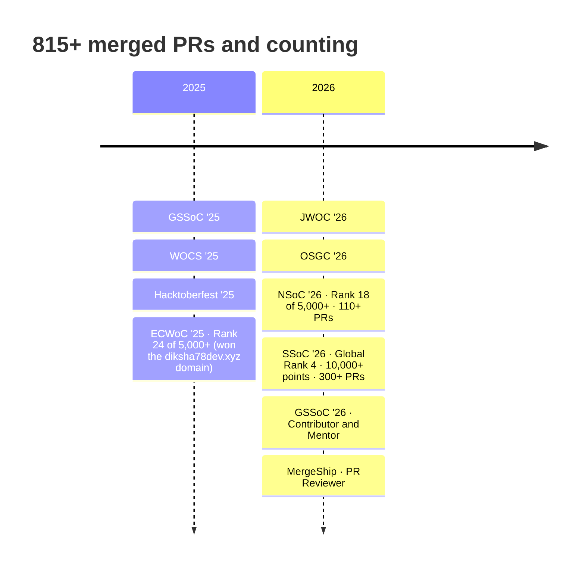

<!-- ════════════════════════════════════════════════════════════════
     diksha78dev · profile README
     Numbers last synced: 10 Nov 2026 (GitHub, LeetCode, diksha78dev.xyz)
     Badges marked "live" update themselves; update the rest by hand.
     ════════════════════════════════════════════════════════════════ -->

<div align="center">


<a href="https://diksha78dev.xyz">

</a>

<br/>

[](https://diksha78dev.xyz)
[](https://linkedin.com/in/dikshadabhole78)
[](https://leetcode.com/u/dikshadabhole78/)
[](https://geeksforgeeks.org/profile/dikshadabhole78)
[](mailto:dikshadabhole78@gmail.com)


</div>

<br/>

<!-- ══════════════ SCOREBOARD ══════════════ -->
<div align="center">
<table>
  <tr>
    <td align="center" width="150"><h2>815+</h2><sub>pull requests merged</sub></td>
    <td align="center" width="150"><h2>844</h2><sub>LeetCode solved<br/>(165 Hard)</sub></td>
    <td align="center" width="150"><h2>#4</h2><sub>global rank<br/>SSoC '26</sub></td>
    <td align="center" width="150"><h2>#18</h2><sub>of 5,000+<br/>NSoC '26</sub></td>
    <td align="center" width="150"><h2>8.25</h2><sub>CGPA<br/>B.Tech CSE '27</sub></td>
  </tr>
</table>
</div>

<br/>

## `01` &nbsp;whoami

```ts
// diksha.config.ts
export const diksha = {
  role:       "Full-Stack + AI Engineer",
  college:    "Rajarambapu Institute of Technology, Islampur · B.Tech CSE · 2027",
  cgpa:       8.25,                                  // Sem 6 SGPA: 8.63

  stack: {
    frontend: ["React", "Next.js", "TypeScript", "Tailwind CSS"],
    backend:  ["Spring Boot", "Spring Security", "Node.js / Express", "FastAPI"],
    data:     ["PostgreSQL", "MySQL", "MongoDB", "Firebase"],
    ai:       ["Gemini API (text + vision)", "Vertex AI", "PyTorch"],
    ship:     ["Docker", "GitHub Actions", "AWS", "Vercel", "Render"],
  },

  nowBuilding: ["BahiSaathi AI dashboard", "Dental caries detection (PyTorch U-Net) · capstone"],
  learning:    ["React Native (Expo)", "System Design", "Agentic AI"],
  alsoSpeaks:  ["English", "Hindi", "Marathi", "German (A1)"],

  openTo: "SDE / Full-Stack roles · 2027",
  motto:  "Ships > Showcases",
} as const;
```

<details>
<summary><b>📖 The story behind the numbers (click to open)</b></summary>
<br/>

I didn't start with big plans. I opened one issue, sent one PR, got it merged, and got hooked. That one PR has turned into **815+**.

My side projects started the same way, from problems I saw around me:

- 🗂️ **FamilyVault** started when I watched my family lose Aadhaar cards and land papers in WhatsApp groups.
- 🧾 **BahiSaathi AI** turns photos of a kirana shop's handwritten *bahi* (ledger) into clean digital records. A shop owner's nephew told me it saves his uncle two hours a day.
- 🗣️ **Samadhan AI** lets people ask questions by voice in Hindi, Marathi, or English, even on a weak connection.
- 🌱 **EcoStep** ranked **#339 of 34,673** at Hack2Skill (top 1%).

I'm a **GSSoC '26 mentor** while still contributing, because teaching is the fastest way I know to learn. I review PRs on **MergeShip**, lead feedback and strategy at **Oyster Kode Club**, and I'm always building something new.

</details>

<br/>

## `02` &nbsp;Stack I've actually shipped with

<div align="center">

<table>
  <tr>
    <td align="right"><b>Frontend</b></td>
    <td></td>
  </tr>
  <tr>
    <td align="right"><b>Backend</b></td>
    <td></td>
  </tr>
  <tr>
    <td align="right"><b>Data</b></td>
    <td></td>
  </tr>
  <tr>
    <td align="right"><b>AI</b></td>
    <td>
      
      
      
    </td>
  </tr>
  <tr>
    <td align="right"><b>Ship</b></td>
    <td>
      
      
    </td>
  </tr>
  <tr>
    <td align="right"><b>Test &amp; tools</b></td>
    <td>
      
      
    </td>
  </tr>
</table>

</div>

<br/>

## `03` &nbsp;Things I've shipped

<table>
  <tr>
    <td width="50%" valign="top">
      <h3>🗂️ <a href="https://github.com/diksha78dev/FamilyVault">FamilyVault</a></h3>
      <sub><b>Full-stack document vault for Indian families</b></sub>
      <p>Families join with one code and share a searchable vault for Aadhaar, land, and medical papers. React client with protected routes; Spring Boot + JPA + MySQL API with JWT, Spring Security, and Cloudinary storage; Dockerized.</p>
      
      
      
      
      <br/><br/>
      🏆 Top 100 / 1,000+ teams · EliteHer Hackathon<br/>
      <a href="https://family-vault-taupe.vercel.app/"><b>Live ↗</b></a> · <a href="https://github.com/diksha78dev/FamilyVault">Code</a>
    </td>
    <td width="50%" valign="top">
      <h3>🏟️ <a href="https://github.com/diksha78dev/stadium-os-ai">StadiumOS AI</a></h3>
      <sub><b>GenAI operations platform for stadiums</b></sub>
      <p>Seven Gemini modules (crowd prediction, route optimization, incident analysis, multilingual help), each with its own API route and prompt, returning confidence-scored recommendations instead of chat.</p>
      
      
      
      
      <br/><br/>
      ✅ 71 tests · Playwright E2E · CI: lint, typecheck, test, build<br/>
      <a href="https://github.com/diksha78dev/stadium-os-ai"><b>Code ↗</b></a>
    </td>
  </tr>
  <tr>
    <td width="50%" valign="top">
      <h3>🧾 <a href="https://github.com/diksha78dev/BahiSaathi">BahiSaathi AI</a></h3>
      <sub><b>Ledger digitization for kirana stores</b></sub>
      <p>Gemini Vision reads photos of handwritten shop ledgers and turns them into structured entries. FastAPI routes secured with JWT, over a four-table PostgreSQL schema.</p>
      
      
      
      <br/><br/>
      🚧 Dashboard and deployment in progress<br/>
      <a href="https://github.com/diksha78dev/BahiSaathi"><b>Code ↗</b></a>
    </td>
    <td width="50%" valign="top">
      <h3>🗣️ <a href="https://github.com/diksha78dev/Samadhan-AI">Samadhan AI</a></h3>
      <sub><b>Voice-first assistant for rural India</b></sub>
      <p>Speak in Hindi, Marathi, or English. React + Web Speech API on the client, Gemini answering through Spring Boot APIs, and an IndexedDB cache so it still works on weak connections.</p>
      
      
      
      <br/><br/>
      📶 Offline-friendly · 3 languages<br/>
      <a href="https://github.com/diksha78dev/Samadhan-AI"><b>Code ↗</b></a>
    </td>
  </tr>
  <tr>
    <td width="50%" valign="top">
      <h3>🌱 <a href="https://github.com/diksha78dev/ecostep">EcoStep</a></h3>
      <sub><b>Carbon-footprint coach for India</b></sub>
      <p>Personal reduction plans based on diet, transport, and energy use, generated with Gemini. Plain JavaScript, tested with Jest.</p>
      
      
      
      <br/><br/>
      🏆 #339 / 34,673 · Hack2Skill (top 1%) · AI score 95.99<br/>
      <a href="https://diksha78dev.github.io/ecostep/"><b>Live ↗</b></a> · <a href="https://github.com/diksha78dev/ecostep">Code</a>
    </td>
    <td width="50%" valign="top">
      <h3>🚗 <a href="https://github.com/diksha78dev/RentOrbits">RentOrbits</a></h3>
      <sub><b>Open-source car rental platform · I maintain it</b></sub>
      <p>React + TypeScript + Tailwind with Firebase Auth and Firestore. I review and merge work from outside contributors.</p>
      
      
      
      <br/><br/>
      
      
      <br/>
      <a href="https://diksha78dev.github.io/RentOrbits/"><b>Live ↗</b></a> · <a href="https://github.com/diksha78dev/RentOrbits">Code</a>
    </td>
  </tr>
</table>

<br/>

## `04` &nbsp;Open source journey



<div align="center">

**Where my PRs landed most**

| Repository | Merged PRs | |
|---|:--:|---|
| [Open-Source-Contribution-Atelier](https://github.com/nandinigoyaldev/Open-Source-Contribution-Atelier) | **197** | 🥇 #1 top contributor |
| [Algo-Infinity-Verse](https://github.com/Eshajha19/Algo-Infinity-Verse) | **137** | |
| [Vector-social-media](https://github.com/Shivayan09/Vector-social-media) | **69** | |
| [Legalassist-AI](https://github.com/AseemPrasad/Legalassist-AI) | **42** | |
| [SOUL_SENSE_EXAM](https://github.com/nupurmadaan04/SOUL_SENSE_EXAM) | **39** | |
| [MergeShip](https://github.com/Coder-s-OG-s/MergeShip) | **31** | 🔍 also a PR reviewer |

<sub>Plus 35+ other codebases. Counts as of Nov 2026.</sub>

</div>

<br/>

## `05` &nbsp;Wins

<div align="center">

| | Achievement | Result |
|:--:|---|:--:|
| 🌟 | **SSoC 2026** · Certificate of Excellence | Global Rank **#4** |
| 🥇 | **NSoC 2026** · Certificate of Excellence | Rank **#18 / 5,000+** |
| 🌍 | **ECWoC 2025** · Top contributor | Rank **#24 / 5,000+** |
| 🌱 | **Hack2Skill India Runs** · EcoStep | Rank **#339 / 34,673** |
| 💜 | **EliteHer Hackathon 2025** · FamilyVault | Top **100 / 1,000+** |
| 🎓 | **GSSoC 2026** · Contributor and first-time Mentor | Mentor |
| 🔥 | **LeetCode** · 500 Days badge · **GFG** #GeekStreak60 × NPCI | Daily habit |
| 🗣️ | **Oyster Kode Club** · Head of Feedback & Future Strategies | **100+** students taught |

</div>

<br/>

## `06` &nbsp;Problem solving

<div align="center">

<a href="https://leetcode.com/u/dikshadabhole78/"></a>

**844 solved** · 232 Easy · 447 Medium · **165 Hard** · Contest rating **1608** (top 24%)

[](https://hackerrank.com/profile/dikshadabhole78)
[](https://codechef.com/users/diksha_d78)
[](https://geeksforgeeks.org/profile/dikshadabhole78)
[](https://unstop.com/u/dikshdab5235)

</div>

<br/>

## `07` &nbsp;GitHub activity

<div align="center">


<picture>
  <source media="(prefers-color-scheme: dark)" srcset="https://raw.githubusercontent.com/diksha78dev/diksha78dev/output/github-contribution-grid-snake-dark.svg"/>
  <source media="(prefers-color-scheme: light)" srcset="https://raw.githubusercontent.com/diksha78dev/diksha78dev/output/github-contribution-grid-snake.svg"/>
  
</picture>

</div>

<br/>

## `08` &nbsp;Certifications

<div align="center">

-4285F4?style=for-the-badge&logo=googlecloud&logoColor=white)


-FF6B35?style=for-the-badge)


</div>

<br/>

## `09` &nbsp;Let's build something

<div align="center">

I'm looking for **SDE / full-stack roles (2027)**, and I'm always up for open-source collaborations.<br/>
Ask me about Spring Boot, Next.js, Gemini, or how to get your first PR merged.

<br/>

[](https://diksha78dev.xyz)
[](https://linkedin.com/in/dikshadabhole78)
[](mailto:dikshadabhole78@gmail.com)

</div>


<div align="center"><sub>Built from scratch with chai ☕ and too many merged PRs · <a href="https://diksha78dev.xyz">diksha78dev.xyz</a></sub></div>
